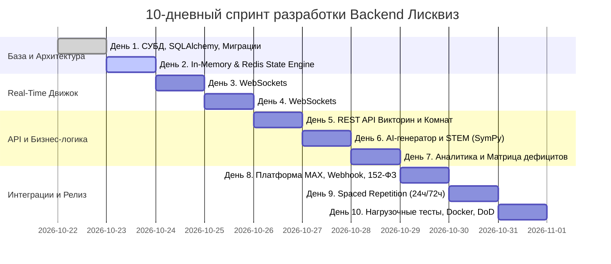

# 🦊 10-дневный план реализации бэкенда платформы «Лисквиз» (Lisquiz)

> **Проект:** Интерактивные экспресс-викторины в Сферуме на платформе MAX  
> **Номинация:** Продвинутая разработка (Docker) — Всероссийский хакатон «Идея фикс» 2026  
> **Стек бэкенда:** Python 3.12, FastAPI, WebSockets, PostgreSQL 16 (SQLAlchemy 2.0 asyncpg), Redis 7, Docker Compose, GigaChat / YandexGPT / SymPy  
> **Ответственные:** Backend-разработчик (*Моргунов Ростислав / Lunarflux-hub*), при участии ML (*Кошельник Иван*) и капитана (*Шабалта Ангелина*)

---

## 🎯 Цели и ключевые метрики 10-дневного спринта

1. **Реализация отказоустойчивого Real-Time движка:** одновременная игра класса (35–40 учеников в комнате) со сквозной задержкой сокетов $\le 50\text{ мс}$.
2. **Нулевые падения и быстрое переподключение:** автоматическое восстановление состояния сессии (`SYNC_STATE`) при сбоях мобильной сети или WebView Сферума.
3. **Бесшовная генерация тестов:** генерация 5–10 вопросов по ФРП за $< 3$ сек (STEM/кэш) и $< 15$ сек (LLM).
4. **Неинвазивный анти-чит:** динамический скоринг по времени чтения ($t_{read}$) и фиксация расфокуса окна (`Page Visibility API`).
5. **Аналитическая диагностическая матрица (Class Gap Heatmap):** автоматическое построение карты дефицитов класса для учителя сразу по окончании викторины.
6. **Полная контейнеризация Docker:** запуск всего бэкенда, БД и брокеров одной командой `docker compose up --build -d`.

---

## 📅 График реализации по дням

---

### День 1: Архитектурный фундамент, База Данных (PostgreSQL 16) и Асинхронные Модели

**Цель дня:** Поднять персистентный слой данных на PostgreSQL 16 с асинхронным драйвером `asyncpg`, спроектировать структуру таблиц и настроить систему миграций Alembic.

#### Задачи к реализации:
- [x] **Настройка окружения и зависимостей:**
  - Обновить `backend/requirements.txt` (проверить версии `sqlalchemy>=2.0.30`, `asyncpg>=0.29.0`, `alembic>=1.13.0`, `redis>=5.0.0`).
  - Проверить настройки подключения в `backend/app/config.py` (параметр `DATABASE_URL`).
- [x] **Сессия и движок базы данных:**
  - Создать `backend/app/db/session.py` с асинхронной фабрикой сессий `async_sessionmaker` и базовым декларативным классом `Base`.
  - Реализовать FastAPI dependency `get_db()` для внедрения сессий в роутеры.
- [x] **Проектирование ORM моделей (`backend/app/db/models.py`):**
  - Таблица `quizzes` (id, title, subject, grade, topic, source_notes, created_at).
  - Таблица `questions` (id, quiz_id, text, explanation, time_limit_sec, topic, kes_code).
  - Таблица `answer_options` (id, question_id, text, is_correct, symbol, color).
  - Таблица `game_rooms` (room_code, quiz_id, status, teacher_id, started_at, finished_at).
  - Таблица `room_participants` (id, room_code, pseudonym_id, name, avatar, score, streak, blurred_count).
  - Таблица `player_answers` (id, room_code, participant_id, question_id, option_id, is_correct, time_taken_sec, tab_blurred).
  - Таблица `gap_reports` (id, room_code, total_participants, avg_score, raw_stats_json, topics_to_review).
  - Таблица `spaced_repetition_queue` (id, pseudonym_id, question_id, topic, step_interval, trigger_at).
- [x] **Инициализация Alembic:**
  - Настроить `alembic.ini` и `backend/migrations/env.py` для асинхронного выполнения миграций.
  - Сгенерировать начальную миграцию: `0001_initial_schema`.

**Критерий приемки (Definition of Done):**
- Docker контейнер `lisquiz_postgres` успешно запускается.
- Миграции накатываются командой `alembic upgrade head` без ошибок.
- Написан тест `tests/test_db_models.py`, проверяющий создание и чтение связей викторины и вопросов.

---

### День 2: In-Memory & Redis State Engine для активных игровых комнат

**Цель дня:** Создать высокопроизводительный движок управления состоянием живых комнат с защитой от race conditions при одновременных ответах учеников.

#### Задачи к реализации:
- [x] **Модуль хранения состояния (`backend/app/services/room_state_engine.py`):**
  - Реализовать класс `RoomStateEngine` с двойным уровнем кэширования:
    - *L1: In-Memory Cache (Python dict + `asyncio.Lock`)* для мгновенного доступа к текущему таймеру и стейту.
    - *L2: Redis Key-Value Store* с TTL 4 часа для персистентности и отказоустойчивости при рестарте контейнера.
- [x] **Конечный автомат жизненного цикла комнаты (Finite State Machine):**
  - Статусы: `LOBBY` $\rightarrow$ `COUNTDOWN` $\rightarrow$ `QUESTION` $\rightarrow$ `REVEAL_RESULTS` $\rightarrow$ `LEADERBOARD` $\rightarrow$ `NEXT_QUESTION` / `FINISHED`.
  - Валидация недопустимых переходов состояний.
- [x] **Генератор PIN-кодов комнат:**
  - 6-значный цифровой код (например `482915`) с проверкой отсутствия коллизий среди активных комнат.
- [x] **Сессионные токены игроков:**
  - Генерация криптографически стойкого сессионного токена (`session_token`) при входе игрока в комнату.
  - Сохранение соответствия `session_token -> {room_code, player_id, role}` в Redis.

**Критерий приемки (Definition of Done):**
- Скорость чтения/записи стейта комнаты $< 2\text{ мс}$.
- Корректная обработка состояния при имитации перезагрузки сервиса (восстановление из Redis).
- Unit-тесты покрывают FSM переходы и генератор PIN-кодов.

---

### День 3: Real-Time WebSocket Engine (Часть 1: Подключение, Лобби, Синхронизация)

**Цель дня:** Построить WebSocket-хаб для подключения участников (учителя и учеников), отображения живого лобби и обработки разрывов соединений.

#### Задачи к реализации:
- [x] **Менеджер WebSocket соединений (`backend/app/services/ws_manager.py`):**
  - Хранение пула активных соединений, сгруппированных по `room_code`.
  - Разделение прав и событий: широковещательные (`broadcast_room`), персональные (`send_personal`), только учителю (`broadcast_teacher`).
- [x] **Эндпоинт WebSocket (`backend/app/api/websocket.py`):**
  - Маршрут: `/ws/rooms/{room_code}`.
  - Аутентификация через query-параметр: `token` (проверка в `RoomStateEngine`).
  - Определение роли: `teacher` (хост игры) или `student` (участник).
- [x] **Протокол сообщений лобби:**
  - Обработка `JOIN_LOBBY`: бродкаст нового игрока `PLAYER_JOINED` всем в комнате.
  - Обработка `KICK_PLAYER`: возможность учителя исключить неподобающий никнейм.
  - Реакция на дисконнект `DISCONNECT`: обновление статуса `connected=False`, оповещение учителя.
- [x] **Механизм Heartbeat (Keep-Alive):**
  - Отправка `PING` раз в 15 секунд, ожидание `PONG` (таймаут 30 секунд до фиксации дисконнекта).
- [x] **Пакет аварийного восстановления (`SYNC_STATE`):**
  - При переподключении клиента отправка полного снапшота: текущий статус комнаты, номер вопроса, оставшиеся миллисекунды таймера (`remaining_time_ms`), статус ответа игрока (`has_answered`).
- [x] **Базовый интерактивный UI фронтенда (`frontend/src/App.tsx`):**
  - Переключение ролей «Учитель» / «Ученик».
  - Создание комнаты, отображение 6-значного PIN-кода, живой список подключенных учеников, исключение участников (Kick), запуск викторины.
  - Вход ученика по PIN и нику, выбор аватара, экран ожидания в лобби с лисёнком Спринтом.

**Критерий приемки (Definition of Done):**
- Подключение 40 виртуальных WebSocket-клиентов к одной комнате в лобби без задержек.
- При отключении и повторном подключении клиент получает актуальный `SYNC_STATE` и сохраняет набранные очки.

---

### День 4: Real-Time WebSocket Engine (Часть 2: Игровой цикл, Скоринг и Анти-чит)

**Цель дня:** Реализовать синхронный запуск вопросов, таймер реального времени, сбор ответов, алгоритм начисления очков и неинвазивную защиту от списывания.

#### Задачи к реализации:
- [x] **Управление таймером вопроса:**
  - Асинхронный фоновый таймер с рассылкой тиков/обратного отсчета (`COUNTDOWN_START`, таймер вопроса).
  - Досрочное завершение вопроса при ответе 100% участников (`all_answered`).
- [x] **Прием и валидация ответов (`SUBMIT_ANSWER`):**
  - Защита от повторного ответа на один и тот же вопрос (идемпотентность).
  - Скрытие правильного ответа от инспектора сети учеников до момента раскрытия результатов.
- [x] **Двухфазная математическая модель скоринга:**
  - Вычисление когнитивного порога чтения: $t_{read} = N_{words} \times 300\text{ мс}$.
  - Формула начисления баллов:
    $$S = S_{base} + S_{speed} \cdot \left(1 - \frac{t - t_{read}}{T_{max} - t_{read}}\right)^{1.5} + S_{streak}$$
  - Если $t < t_{read}$ (клик наугад без чтения) $\rightarrow$ $S_{speed} = 0$.
- [x] **Неинвазивный анти-чит (Page Visibility & Blur):**
  - Клиентский хук `visibilitychange` и `blur`, отправка `CHEAT_SUSPECTED`.
  - Предупреждение ученику, аннулирование скоростного бонуса и алерт учителю (`CHEAT_ALERT`).
- [x] **Механика командной «Рощи класса» (Class Grove):**
  - Конвертация суммы правильных ответов класса в процент роста виртуального дерева (`grove_energy`).
- [x] **Бродкаст результатов вопроса и лидерборд:**
  - Событие `QUESTION_RESULTS`: распределение ответов класса по вариантам (гистограмма) и методическое пояснение.
  - Событие `LEADERBOARD_UPDATE`: топ-5 класса + персональная позиция ученика.
- [x] **Сквозной базовый UI игрового цикла (`frontend/src/App.tsx`):**
  - Режим Учителя: создание комнаты, PIN, живое лобби, отсчет 3..2..1, просмотр вопроса и статуса ответов, распределение ответов, лидерборд, итоговый отчет дефицитов класса (Gap Report).
  - Режим Ученика: вход по PIN, выбор аватара, экран ожидания, отсчет, цветные кнопки ответов (▲, ◆, ●, ■), защита от расфокуса, карточка обратной связи («Верно! +баллы»), персональное место в классе, финальный экран.

**Критерий приемки (Definition of Done):**
- Сквозной тест `tests/test_game_loop.py` проходит со 100% успехом (24 теста в общем наборе).
- Фронтенд собирается (`npm run build`) без ошибок TypeScript/Vite и работает на `http://localhost:3000`.

---

### День 5: REST API управления викторинами и комнатами

**Цель дня:** Реализовать стабильные REST-эндпоинты для учителя и учеников, валидацию Pydantic v2 и обработку ошибок.

#### Задачи к реализации:
- [ ] **Роутер викторин (`backend/app/api/routes_quiz.py`):**
  - `POST /api/quiz` — сохранение отредактированной викторины.
  - `GET /api/quiz/{id}` — получение структуры викторины с вопросами.
  - `GET /api/quiz/catalog/topics` — предзагруженный справочник школьных предметов, классов (1–11) и типовых тем по ФРП РФ.
  - `DELETE /api/quiz/{id}` — удаление викторины.
- [ ] **Роутер комнат (`backend/app/api/routes_rooms.py`):**
  - `POST /api/rooms` — создание новой игровой комнаты учителем (выбор `quiz_id`, генерация `room_code`).
  - `GET /api/rooms/{room_code}` — проверка существования комнаты и получение статуса (для экрана ввода PIN учеником).
  - `POST /api/rooms/{room_code}/join` — вход ученика (передача ника и аватара, выдача `session_token`).
  - `POST /api/rooms/{room_code}/control` — команды учителя (`START_GAME`, `NEXT_QUESTION`, `PAUSE`, `FINISH`).
- [ ] **Стандартизация ответов и обработка ошибок:**
  - Единая схема ошибки: `{"detail": str, "code": str, "timestamp": str}`.
  - Глобальные exception handlers для `ValidationError`, `EntityNotFound`, `RoomFullException`.

**Критерий приемки (Definition of Done):**
- Swagger/OpenAPI документация (`/docs`) содержит все схемы запросов/ответов с примерами.
- Написаны интеграционные тесты `tests/test_routes_rooms.py` и `tests/test_routes_quiz.py`.

---

### День 6: AI/ML Генератор тестов и параметрический STEM-модуль (SymPy)

**Цель дня:** Обеспечить стабильную, дешевую и быструю генерацию проверочных тестов с защитой от галлюцинаций и поддержкой математических формул в LaTeX.

#### Задачи к реализации:
- [ ] **Паттерн «Стратегия» в AI-сервисе (`backend/app/services/ai_service.py`):**
  - Провайдер `GigaChatProvider` (авторизация OAuth2 Sber, автообновление bearer-токена, вызов с JSON mode).
  - Провайдер `YandexGPTProvider` (API-ключ + Folder ID, форматирование промпта).
  - Провайдер `MockProvider` для локальной разработки и тестов без расхода API-лимитов.
- [ ] **Параметрический генератор точных наук (STEM) на базе SymPy (`backend/app/services/stem_generator.py`):**
  - Генерация шаблонов: линейные уравнения ($ax + b = c$), дроби ($\frac{a}{b} \pm \frac{c}{d}$), проценты, степени.
  - Автоматический расчет правильного корня и моделирование типичных детских ошибок для дистракторов (забыл перенести знак, перепутал числитель и знаменатель).
  - Время генерации $< 1\text{ мс}$, нулевая стоимость, 100% математическая точность.
- [ ] **Валидация и экранирование LaTeX для React-фронтенда:**
  - Автоматическая нормализация обратных слэшей в JSON (`\\frac`, `\\sqrt`, `\\cdot`) по стандарту RFC 8259.
- [ ] **Пятиуровневый фильтр (Cache-First архитектура):**
  - Поиск готовой викторины в кэше PostgreSQL $\rightarrow$ STEM-генератор $\rightarrow$ Банк ФРП $\rightarrow$ Облачная LLM.

**Критерий приемки (Definition of Done):**
- Запрос на создание викторины по математике отрабатывает за $< 2$ секунды без вызова внешних платных LLM.
- При запросе произвольной темы по литературе/истории GigaChat возвращает валидный JSON, строго проходящий Pydantic-схему `Quiz`.

---

### День 7: Аналитическая диагностическая матрица учителя (Class Gap Heatmap)

**Цель дня:** Автоматизировать сбор данных игры и формирование карты когнитивных пробелов класса с рекомендациями к домашнему заданию.

#### Задачи к реализации:
- [ ] **Сервис агрегации аналитики (`backend/app/services/analytics_service.py`):**
  - Сохранение каждого ответа в таблицу `player_answers` с временной меткой.
  - Расчет процента успешности по каждому вопросу и микро-теме.
  - Определение *преобладающего ошибочного дистрактора* (какой неверный ответ выбирало большинство).
  - Формирование формулировки выявленной когнитивной ошибки (например: *«Ошибка перевода единиц измерения из см в м»*).
- [ ] **Сводка честности участников:**
  - Выделение участников с флагом `blurred_count > 1` (подозрение на поиск ответов в сторонних вкладках).
- [ ] **Генерация отчета:**
  - Эндпоинт `GET /api/rooms/{room_code}/report` — JSON диагностической матрицы для интерактивного дашборда учителя.
  - Экспорт в CSV/Excel (`/api/rooms/{room_code}/export/csv`) для быстрой вставки в электронный журнал.
- [ ] **Сохранение отчета в БД:**
  - Запись итоговой аналитики в `gap_reports` для долговременного доступа учителя.

**Критерий приемки (Definition of Done):**
- Отчет генерируется мгновенно ($< 150\text{ мс}$) при завершении игры.
- Отчет содержит: средний балл, процент по каждому вопросу, топ-3 проблемных тем и список тем на повторение.

---

### День 8: Интеграция с платформой MAX (Сферум), Вебхуки и Безопасность 152-ФЗ

**Цель дня:** Реализовать интеграцию с экосистемой Сферум/MAX, настроить валидацию стартовых параметров мини-приложения и обработку команд чат-бота.

#### Задачи к реализации:
- [ ] **Безопасность и соответствие 152-ФЗ (Zero-PII контур):**
  - Валидация цифровой подписи `initData` от платформы MAX через HMAC-SHA256 с использованием `MAX_APP_SECRET`.
  - Псевдонимизация пользователей: $PID = \text{HMAC-SHA256}(\text{max\_user\_id}, \text{SECRET\_SALT})$.
  - Никакие персональные данные (ФИО, телефоны, школы) не сохраняются в БД.
- [ ] **Модуль вебхуков бота MAX (`backend/app/api/routes_max.py`):**
  - Эндпоинт `POST /api/max/webhook` для приема событий от чат-бота.
  - Обработка команд:
    - `/start` — приветствие от маскота лисёнка Спринта, кнопки «Создать викторину» и «Войти по PIN».
    - `/quiz <PIN>` — быстрая карточка с кнопкой бесшовного перехода в мини-приложение.
    - `/stats` — просмотр последних результатов для учителя.
- [ ] **Отправка интерактивных карточек в чат класса (`backend/app/services/max_bot_service.py`):**
  - Генерация карточки викторины с ярким баннером, темой урока и кнопкой `Launch WebApp`.

**Критерий приемки (Definition of Done):**
- Подпись `initData` валидируется с отсечением поддельных запросов (возврат 401 Unauthorized).
- Вебхук бота отвечает на `/start` и формирует корректное JSON-сообщение по спецификации MAX API.

---

### День 9: Замкнутый цикл интервального повторения (Closed-Loop Spaced Retrieval)

**Цель дня:** Построить механизм персонализированной отработки ошибок через 24 и 72 часа через бота Сферум.

#### Задачи к реализации:
- [ ] **Фиксация дефицитов памяти:**
  - При ошибке ученика создается запись в таблице `spaced_repetition_queue` (pseudonym_id, question_id, topic, mistake_date, next_trigger_date, interval_step).
- [ ] **Фоновый планировщик задач (`backend/app/services/scheduler.py`):**
  - Использование легковесного `APScheduler` или асинхронного фонового цикла `asyncio.sleep()`.
  - Проверка очереди задач каждые 15 минут.
- [ ] **Сценарии интервенций лисёнка Спринта:**
  - **Интервал 1 (через 24 часа):** бот отправляет ученику личное сообщение: *«Привет! Лисёнок Спринт разбирает вчерашние задачки по дробям. Давай решим одну вместе?»* + 2 вопроса на закрепление.
  - **Интервал 2 (через 72 часа):** контрольный синтезирующий вопрос.
- [ ] **Геймификация отработки:**
  - Начисление валюты «Жёлуди знаний» за решение отложенных заданий.

**Критерий приемки (Definition of Done):**
- Автотест эмулирует наступление 24-часового интервала, задача извлекается из очереди, генерируется персональный push-пакет для бота MAX.

---

### День 10: Нагрузочное тестирование, Оптимизация Docker, E2E проверка и Финал

**Цель дня:** Провести стресс-тестирование, оптимизировать сборку контейнеров, убедиться в бесшовном развертывании проекта одной командой и подготовить документацию к защите.

#### Задачи к реализации:
- [ ] **Нагрузочный стресс-тест Real-Time подсистемы:**
  - Написать скрипт `scripts/load_test_sockets.py` (эмуляция 5 одновременных комнат по 35 учеников = 175 параллельных WebSocket соединений).
  - Замер задержки бродкаста (target: $< 50\text{ мс}$) и потребления памяти (RAM $< 250\text{ МБ}$).
- [ ] **Оптимизация Docker контейнеров:**
  - Проверить `backend/Dockerfile`:
    - Использование минимального базового образа `python:3.12-slim`.
    - Безопасность: запуск от непривилегированного пользователя `appuser`.
    - Очистка кэша pip (`--no-cache-dir`) для уменьшения размера образа.
  - Проверить `docker-compose.yml`:
    - Наличие `healthcheck` для PostgreSQL и Redis.
    - Перезапуск контейнеров `restart: unless-stopped`.
- [ ] **Сквозная проверка полного пользовательского пути (E2E):**
  - Учитель создает викторину (ИИ/STEM) $\rightarrow$ Получает PIN $\rightarrow$ 3 ученика входят в лобби $\rightarrow$ Учитель жмет «Старт» $\rightarrow$ Все отвечают на вопросы $\rightarrow$ Отображаются лидерборд и Роща класса $\rightarrow$ Формируется Gap Report.
- [ ] **Финализация документации:**
  - Проверить актуальность Swagger/OpenAPI спецификации.
  - Подготовить краткую шпаргалку для жюри по проверке API.

**Критерий приемки (Definition of Done):**
- Команда `docker compose up --build -d` поднимает всю систему с нуля на чистой машине.
- Тестовый сценарий проходит без ошибок 500 и обрывов сокетов.
- Бэкенд готов к интеграции с фронтендом и демонстрации экспертам хакатона.

---

## 🛡️ Матрица рисков и стратегии их минимизации

| Риск | Вероятность | Влияние | Стратегия предотвращения |
| :--- | :---: | :---: | :--- |
| **Нестабильность внешних LLM API (GigaChat/Yandex)** | Средняя | Высокое | Fallback на параметрический SymPy-генератор и офлайн-банк вопросов ФРП (система работает даже при отключенном интернете). |
| **Обрывы соединения у учеников (мобильный 3G/LTE)** | Высокая | Высокое | Легковесный пакет `SYNC_STATE` и сохранение сессии в Redis. Ученик возвращается ровно на текущую секунду вопроса. |
| **Race Conditions при одновременной отправке ответов** | Средняя | Средняя | `asyncio.Lock` на уровне комнаты + транзакционность в сессиях SQLAlchemy / Redis atomic increments. |
| **Проблемы с невалидными именами файлов на Windows** | Низкая | Средняя | В репозитории уже настроен `sparse-checkout`, исключающий некорректные спецсимволы. |
| **Превышение лимитов памяти на сервере хакатона** | Низкая | Высокая | Замена тяжелых векторных баз на локальный PostgreSQL, отказ от локальных SLM 7B в пользу легковесных API/SymPy. |
