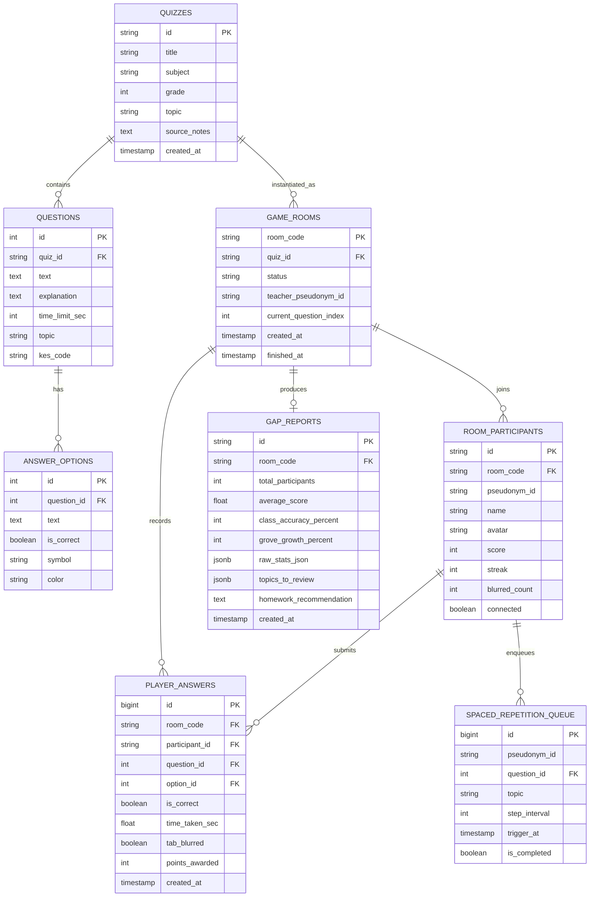

# 🗄️ Архитектура базы данных и кэширования платформы «Лисквиз» (Lisquiz)

> СУБД: **PostgreSQL 16** (драйвер `asyncpg`, ORM `SQLAlchemy 2.0`)  
> Кэш / State Store: **Redis 7** (In-Memory K/V + PubSub)  
> Миграции: **Alembic**  
> Требования: **152-ФЗ (Zero-PII)**, высокая скорость записи ответов при одновременной игре 40 учеников.

---

## 1. Концепция хранения данных и 152-ФЗ

Платформа Лисквиз строго изолирована от персональных данных учащихся (ФИО, телефоны, email, школы). 
- Вместо реальных ID пользователя Сферума используется псевдонимизированный хэш:
  $$PID = \text{HMAC-SHA256}(\text{max\_user\_id}, \text{SECRET\_SALT})$$
- Игровые никнеймы (`name`) выбираются учеником произвольно или генерируются случайно (например: *«Быстрый Лисёнок»*, *«Мудрый Филин»*).
- Сессионные данные живой игры хранятся в **Redis** (L1 кэш) с последующей асинхронной фиксацией агрегированных итогов в **PostgreSQL** (L2 персистентный слой).

---

## 2. Диаграмма связей сущностей (ER-диаграмма)

---

## 3. Описание таблиц PostgreSQL 16

### 3.1. Таблица `quizzes` (Банк и шаблоны викторин)
| Колонка | Тип | Ограничения | Описание |
| :--- | :--- | :--- | :--- |
| `id` | `VARCHAR(36)` | PRIMARY KEY | Уникальный ID викторины (`quiz_...`) |
| `title` | `VARCHAR(255)` | NOT NULL | Название викторины |
| `subject` | `VARCHAR(100)` | NOT NULL | Предмет (Математика, Физика и т.д.) |
| `grade` | `SMALLINT` | NOT NULL | Класс (1–11) |
| `topic` | `VARCHAR(255)` | NOT NULL | Тема по ФРП |
| `source_notes` | `TEXT` | NULL | Исходный конспект/заметки учителя |
| `is_verified` | `BOOLEAN` | DEFAULT FALSE | Проверена ли методистом |
| `created_at` | `TIMESTAMP WITH TIME ZONE` | DEFAULT NOW() | Время создания |

*Индексы:* `CREATE INDEX idx_quizzes_subject_grade ON quizzes(subject, grade);`

### 3.2. Таблица `questions` (Вопросы)
| Колонка | Тип | Ограничения | Описание |
| :--- | :--- | :--- | :--- |
| `id` | `SERIAL` | PRIMARY KEY | Инкрементный ID вопроса |
| `quiz_id` | `VARCHAR(36)` | REFERENCES `quizzes(id)` ON DELETE CASCADE | Внешний ключ на викторину |
| `order_index` | `SMALLINT` | NOT NULL | Порядковый номер в викторине (0..N) |
| `text` | `TEXT` | NOT NULL | Текст вопроса (поддержка LaTeX) |
| `explanation` | `TEXT` | NULL | Методическое пояснение решения |
| `time_limit_sec`| `SMALLINT` | DEFAULT 20 | Лимит времени на ответ (сек) |
| `topic` | `VARCHAR(255)` | NULL | Уточненная микро-тема вопроса |
| `kes_code` | `VARCHAR(50)` | NULL | Код КЭС (ФИПИ) |

### 3.3. Таблица `answer_options` (Варианты ответа)
| Колонка | Тип | Ограничения | Описание |
| :--- | :--- | :--- | :--- |
| `id` | `SERIAL` | PRIMARY KEY | ID варианта |
| `question_id` | `INTEGER` | REFERENCES `questions(id)` ON DELETE CASCADE | Внешний ключ на вопрос |
| `text` | `TEXT` | NOT NULL | Текст варианта (поддержка LaTeX) |
| `is_correct` | `BOOLEAN` | NOT NULL DEFAULT FALSE | Флаг правильного ответа |
| `symbol` | `VARCHAR(20)` | NULL | Фигура (triangle, diamond, circle, square) |
| `color` | `VARCHAR(20)` | NULL | Цвет кнопки (orange, blue, yellow, green) |

### 3.4. Таблица `game_rooms` (Игровые сессии)
| Колонка | Тип | Ограничения | Описание |
| :--- | :--- | :--- | :--- |
| `room_code` | `VARCHAR(6)` | PRIMARY KEY | 6-значный PIN-код комнаты |
| `quiz_id` | `VARCHAR(36)` | REFERENCES `quizzes(id)` | Разыгрываемая викторина |
| `status` | `VARCHAR(20)` | NOT NULL DEFAULT 'lobby' | `lobby`, `playing`, `finished` |
| `teacher_pseudonym_id`| `VARCHAR(64)` | NOT NULL | Хэш учителя |
| `started_at` | `TIMESTAMP WITH TIME ZONE` | NULL | Время старта игры |
| `finished_at`| `TIMESTAMP WITH TIME ZONE` | NULL | Время завершения игры |

### 3.5. Таблица `player_answers` (Сбор ответов)
| Колонка | Тип | Ограничения | Описание |
| :--- | :--- | :--- | :--- |
| `id` | `BIGSERIAL` | PRIMARY KEY | Уникальный ID записи ответа |
| `room_code` | `VARCHAR(6)` | NOT NULL | Код комнаты |
| `participant_id` | `VARCHAR(36)` | NOT NULL | ID игрока в комнате |
| `question_id` | `INTEGER` | NOT NULL | ID вопроса |
| `option_id` | `INTEGER` | NOT NULL | Выбранный вариант |
| `is_correct` | `BOOLEAN` | NOT NULL | Результат проверки |
| `time_taken_sec`| `NUMERIC(5,2)` | NOT NULL | Время до клика (сек) |
| `tab_blurred` | `BOOLEAN` | DEFAULT FALSE | Был ли зафиксирован расфокус окна |
| `points_awarded`| `INTEGER` | DEFAULT 0 | Начисленные баллы за вопрос |
| `created_at` | `TIMESTAMP WITH TIME ZONE` | DEFAULT NOW() | Время ответа |

*Индексы:* `CREATE INDEX idx_answers_room_question ON player_answers(room_code, question_id);`

### 3.6. Таблица `gap_reports` (Диагностическая матрица пробелов)
| Колонка | Тип | Ограничения | Описание |
| :--- | :--- | :--- | :--- |
| `id` | `VARCHAR(36)` | PRIMARY KEY | ID отчета |
| `room_code` | `VARCHAR(6)` | UNIQUE NOT NULL | Код завершенной комнаты |
| `total_participants`| `INTEGER` | NOT NULL | Число участников |
| `average_score` | `NUMERIC(7,1)` | NOT NULL | Средний балл класса |
| `class_accuracy_percent` | `SMALLINT` | NOT NULL | Общий процент правильных ответов |
| `grove_growth_percent` | `SMALLINT` | NOT NULL | Итоговая энергия Рощи класса |
| `raw_stats_json` | `JSONB` | NOT NULL | Полный JSON статистики по вопросам и дистракторам |
| `topics_to_review`| `JSONB` | NOT NULL | Список тем для повторения |
| `homework_recommendation` | `TEXT` | NOT NULL | Текст рекомендации для домашнего задания |
| `created_at` | `TIMESTAMP WITH TIME ZONE` | DEFAULT NOW() | Время генерации |

---

## 4. Архитектура кэша Redis 7 (L1 State Store)

Для обеспечения мгновенной реакции сокетов ($\le 50\text{ мс}$) состояние активных сессий хранится в оперативной памяти Redis.

### 4.1. Ключи и структуры Redis:

1. **Состояние комнаты:**  
   `room:{room_code}:state` $\rightarrow$ `HASH` (TTL 4 часа)
   - `status`: `"playing"`
   - `quiz_id`: `"quiz_a7f9b2c1"`
   - `cur_q_idx`: `2`
   - `q_start_time_epoch_ms`: `1771584000120`
   - `grove_energy`: `45`

2. **Игроки в комнате:**  
   `room:{room_code}:players` $\rightarrow$ `HASH` (field: `player_id`, value: `JSON Player Object`)

3. **Лидерборд реального времени (Sorted Set):**  
   `room:{room_code}:leaderboard` $\rightarrow$ `ZSET`  
   - Member: `player_id`
   - Score: `total_score` (мгновенное получение топ-5 через `ZREVRANGE`)

4. **Защита от повторного ответа:**  
   `room:{room_code}:q:{question_id}:answered` $\rightarrow$ `SET`  
   - Хранит `player_id`, ответивших на текущий вопрос (`SADD` возвращает 0 при попытке повтора).

5. **Сессионный токен игрока:**  
   `session:{session_token}` $\rightarrow$ `STRING (JSON)` (TTL 12 часов)
   - Значение: `{"room_code": "482915", "player_id": "p_91b4ca", "role": "student"}`

---

## 5. Стратегия миграций Alembic

- Все изменения схемы БД оформляются строго через версионированные миграции в `backend/migrations/versions/`.
- Автоматическая проверка миграций при запуске контейнера бэкенда через `alembic upgrade head` в `entrypoint.sh`.
